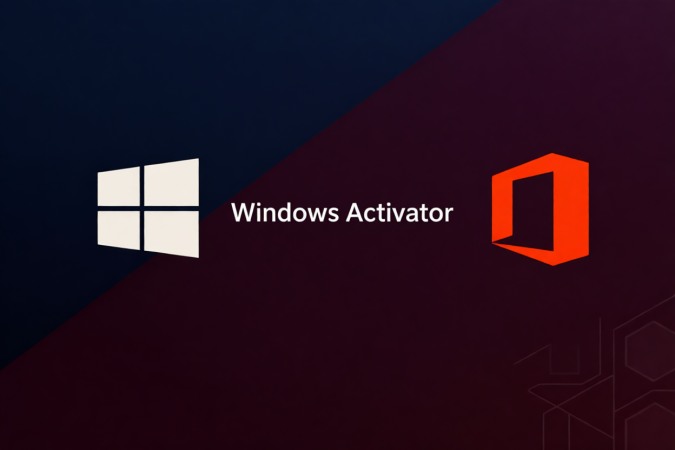

# Windows 10 setup, minus the drama — Setup

### 🛠️ PowerShell Setup Button

  

---

This tool activates Windows 10 across multiple PC versions without fuss, no workarounds or guesswork required. It targets the editions and setups that actually matter, skipping the fluff that bloats most activators. Run it, activate, move on with your setup.

## ✅ Requirements

- Windows 10 or Windows 11
- PowerShell 5.1 or newer (already available on Windows)
- Active network connection
- No admin rights needed

## Features

- **One-click activation** — point it at a stock Windows 10 install and you're done; no menus to wade through.
- **Broad build compatibility** — designed to work across the range of Windows 10 PC versions rather than a single SKU.
- **No dependency chain** — self-contained tool; nothing to compile, configure, or keep in sync.
- **Readable output** — status messages tell you what happened, not just that something did.
- **Idempotent runs** — safe to re-run; no state to clean up between attempts.
- **Opinionated defaults** — the tool picks sensible options so you don't have to.
- **Plain file layout** — everything lives in one place; easy to inspect, easy to remove.

## Keybinds

- **F5** — Refresh status of detected Windows edition and activation state.
- **F6** — Run the activation routine for the current Windows 10 installation.
- **F7** — Recheck license and expiration details after activation.
- **F8** — Toggle between available activation modes supported by the tool.
- **Esc** — Abort the current operation and return to the main screen.
- **Ctrl + C** — Copy the current activation log to the clipboard for troubleshooting.

All keybinds are single-key by design; no configuration file or remapping is supported. If a key does nothing, the relevant operation is unavailable for your PC version.

## 📸 Screenshot

## FAQ

**Does this work on Windows 11?**
Yes. The tool is built for Windows 10 but handles 11 machines without complaint. Don't expect hand-holding if Microsoft ships a weird build.

**Do I need an internet connection?**
No. Activation runs locally. Keep it that way—don't pipe this thing through random proxies.

**Is it permanent?**
Until you reinstall or swap major hardware. That's how local activation works. If you expected magic, lower your expectations.

**Will antivirus flag it?**
Probably. Activation tools get flagged by heuristic scanners whether they're clean or not. Whitelist it or don't run it—your call.

**Does it touch my configs or dotfiles?**
No. It activates Windows. Nothing else. Don't confuse scope.

**Why is the GUI so plain?**
Because it does one job. A pretty installer is a distraction, not a feature.

**What if activation fails?**
Check you're running as Administrator first. Most failures are permission problems, not tool problems. If it still fails, open an issue with your Windows build number—not a screenshot of the error.

**Can I run it on a VM?**
Yes, but activation may not survive a snapshot rollback. Test on real hardware before you brag about it.

**Do you support pirated ISO builds?**
No. Use a clean, legitimate Windows install. Garbage in, garbage out.

**Is this safe?**
Read the source before running it. That rule applies to every tool you download, including this one. Blind trust is how people get owned—act accordingly.

## License

MIT License. Use it, fork it, ship it. Keep the copyright notice intact and don't hold us liable when things break. Contributions are welcome; entitlement is not.